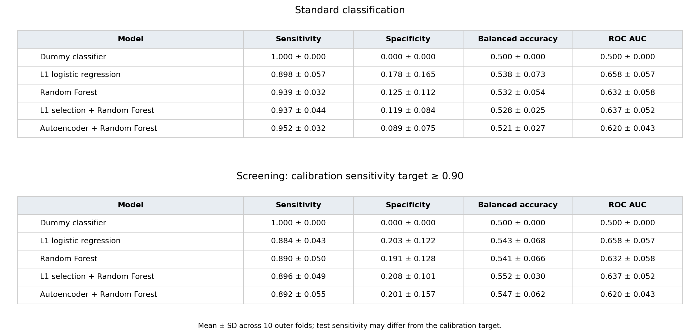

## 🧠 EEG-based Psychiatric Screening Pipeline

**EEG-anomaly-detection** explores whether EEG spectral features can distinguish patients with psychiatric disorders from healthy controls.

The project started with exploratory analysis and anomaly detection, then developed into a comparison of supervised classifiers and two hybrid approaches: **L1 feature selection + Random Forest** and **Autoencoder + Random Forest**.

**Research question:**  
Do feature selection and learned representations improve binary classification compared with individual classifiers and a Dummy baseline?

---

## ✨ Key Features

- **Exploratory analysis:** Demographics, diagnostic-group composition and spectral patterns.
- **Anomaly detection:** Initial experiments with Isolation Forest and a healthy-reference autoencoder.
- **Feature selection:** Selection of 20 spectral features using L1-regularized logistic regression.
- **Representation learning:** Compression of 114 spectral features into 32 latent features using an autoencoder.
- **Model comparison:** Dummy, L1 logistic regression, Random Forest and two hybrid approaches.
- **Screening evaluation:** Threshold selection prioritising patient detection, with separate calibration and test data.

---

## 📂 Data & Problem Setting

- **Dataset:** [EEG Psychiatric Disorders Dataset](https://www.kaggle.com/datasets/shashwatwork/eeg-psychiatric-disorders-dataset).
- **Analysis sample:** 599 participants aged 18–30: 515 patients and 84 healthy controls.
- **Input:** 114 absolute-power features across six frequency bands and 19 electrodes.
- **Task:** Binary classification — patients versus healthy controls. Individual psychiatric diagnoses are not predicted.
- **Labels:** `0` = patient, `1` = healthy control.

The project uses extracted spectral features rather than raw EEG recordings.

---

## 🧮 Methods

| Approach | Description |
| --- | --- |
| Dummy classifier | Always predicts the majority class: patients |
| L1 logistic regression | Classification using standardized spectral features |
| Random Forest | Classification using all 114 spectral features |
| L1 + Random Forest | Classification using 20 features selected through L1 coefficients |
| Autoencoder + Random Forest | Classification using 32 learned latent features |

The hybrid approaches are evaluated separately. L1 selection and autoencoder representations are alternative ways of processing features before Random Forest classification.

### Evaluation Protocol

- Five outer folds repeated twice, giving ten outer evaluations.
- Identical spectral profiles kept together during splitting to prevent data leakage.
- Approximately 60% fitting, 20% calibration and 20% testing in each evaluation.
- Three-fold inner cross-validation for hyperparameter selection using balanced accuracy.
- Scaling, feature selection and representation learning fitted within the training process.
- Screening thresholds selected to maximise specificity while achieving sensitivity ≥ 0.90 on calibration data.
- Thresholds applied unchanged to test data, where sensitivity may differ from the calibration target.

---

## 📊 Results

**Test performance with calibration-selected screening thresholds:**

| Model | Sensitivity | Specificity | Balanced accuracy | ROC AUC |
| --- | --- | --- | --- | --- |
| Dummy classifier | 1.000 ± 0.000 | 0.000 ± 0.000 | 0.500 ± 0.000 | 0.500 ± 0.000 |
| L1 logistic regression | 0.884 ± 0.043 | 0.203 ± 0.122 | 0.543 ± 0.068 | 0.658 ± 0.057 |
| Random Forest | 0.890 ± 0.050 | 0.191 ± 0.128 | 0.541 ± 0.066 | 0.632 ± 0.058 |
| L1 + Random Forest | 0.896 ± 0.049 | 0.208 ± 0.101 | 0.552 ± 0.030 | 0.637 ± 0.052 |
| Autoencoder + Random Forest | 0.892 ± 0.055 | 0.201 ± 0.157 | 0.547 ± 0.062 | 0.620 ± 0.043 |

Values are mean ± standard deviation across ten outer evaluations. As participants are reused across evaluations, these standard deviations describe variation across splits rather than confidence intervals.

### Main Findings

- Learned models correctly excluded approximately one fifth of healthy controls while detecting about nine tenths of patients.
- **L1 + Random Forest** achieved the highest mean balanced accuracy at the calibrated thresholds.
- **L1 logistic regression** achieved the highest mean ROC AUC.
- Neither hybrid demonstrated a clear, reliable advantage over individual classifiers.
- Dummy detected every patient but excluded no healthy controls, illustrating why patient F1 alone is insufficient for evaluating this imbalanced task.

The models achieved partial discrimination, but the results do not establish practical screening usefulness. Selected features and latent representations have not been validated as clinical biomarkers.

[Full results: standard and calibrated prediction](eeg_anomaly_detection/results/tables/final_metrics.md)



---

## 🗂 Repository Structure

- **`eeg_anomaly_detection/`** — analysis scripts, model comparisons and supporting Python modules.
- **`initial_project_artifacts/`** — initial saved models, transformed features and data splits. These historical artifacts do not correspond to the latest evaluation results.
- **`results/figures/`** — visualizations and the final comparison figure.
- **`results/tables/`** — feature-analysis tables and final evaluation metrics.
- **[paper1.pdf](paper1.pdf)** — exploratory analysis and initial anomaly-detection study.
- **[paper2.pdf](paper2.pdf)** — supervised and hybrid classification study.

The artifact and results directories are inside `eeg_anomaly_detection/`. Intermediate experiment outputs and caches are generated locally and excluded from Git.

---

## 🛠 Tech Stack

- **Language:** Python
- **Neural networks:** TensorFlow / Keras
- **Machine learning:** scikit-learn
- **Data analysis:** pandas, NumPy, SciPy
- **Visualization:** Matplotlib, Seaborn

---

## ⚡️ Quick Start

```bash
git clone https://github.com/nekihlep/EEG-anomaly-detection.git
cd EEG-anomaly-detection
pip install -r requirements.txt
python eeg_anomaly_detection/main.py screening
```

This runs the comparison of five approaches with screening-threshold calibration across ten outer folds. Completed folds are saved so interrupted runs can resume.

Generated results are saved in `eeg_anomaly_detection/results/screening_comparison/`.

---

## 🚀 Future Directions & Limitations

Further work will investigate coherence features and alternative representations, followed by validation on independent data.

Current limitations include a small healthy-control group, heterogeneous diagnoses, unadjusted medication and demographic effects, and evaluation on previously explored data.

This is an exploratory research project. Model outputs are not psychiatric diagnoses and are not intended for clinical use.
